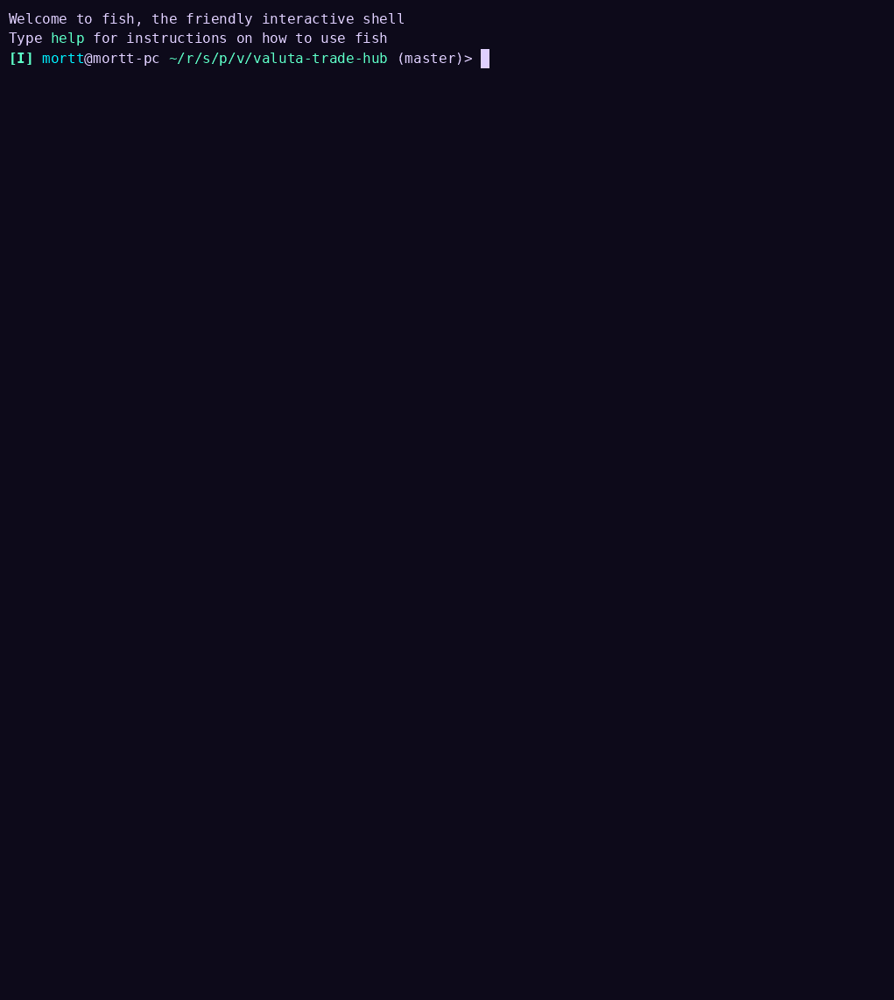

# ValutaTrade Hub

Консольная платформа для учебной торговли фиатными и криптовалютами. Пользователь регистрируется, пополняет
USD-кошелек, покупает и продает валюты по актуальным курсам и отслеживает стоимость портфеля. Курсы загружает
Parser Service из CoinGecko (криптовалюты) и ExchangeRate-API (фиатные валюты) и сохраняет в локальный кеш.

## Демо



## Структура проекта

```
data/
  config.json            конфигурация (TTL, пути, базовая валюта, логи)
  users.json             пользователи
  portfolios.json        портфели и кошельки
  rates.json             кеш текущих курсов
  exchange_rates.json    история измерений курсов
  logs/                  журнал операций buy/sell
src/valuta_trade_hub/
  logging_config.py      настройка журнала Parser Service
  decorators.py          декоратор @log_action
  core/                  модели, usecases, валюты, исключения
  infra/settings.py      SettingsLoader (Singleton)
  parser_service/        API-клиенты, обновление и хранение курсов, планировщик
  cli/interface.py       интерактивный CLI
```

Отсутствующие файлы в `data/` создаются автоматически при первом обращении.

## Установка и запуск

Требуется Python 3.12 и [uv](https://docs.astral.sh/uv/).

```
uv sync
uv run valuta-trade-hub
```

Проверка стиля: `uv run ruff check`.

## API-ключ

Курсы фиатных валют требуют ключ ExchangeRate-API (бесплатная регистрация на https://www.exchangerate-api.com/).
Ключ передается через переменную окружения и не хранится в коде:

```
export EXCHANGERATE_API_KEY="ваш_ключ"
```

Для CoinGecko в ключе нет необходимости.

## Команды CLI

```
> register --username alice --password 1234
> login --username alice --password 1234
> buy --currency USD --amount 1000          # пополнение USD-кошелька
> buy --currency BTC --amount 0.01          # оплата списывается с USD-кошелька
> sell --currency BTC --amount 0.005        # выручка зачисляется на USD-кошелек
> show-portfolio --base EUR                 # по умолчанию база USD
> get-rate --from BTC --to EUR
> update-rates
> show-rates
> exit
```

Кошелек валюты создается автоматически при первой покупке. Поддерживаемые валюты: USD, EUR, RUB, GBP, BTC, ETH, SOL.

Основные ошибки выводятся понятными сообщениями: "Сначала выполните login", "Недостаточно средств: доступно ...
требуется ...", "Неизвестная валюта '...'", "Ошибка при обращении к внешнему API: ...".

## Кеш курсов и TTL

Core Service читает курсы только из `data/rates.json`. Срок актуальности кеша задается параметром `rates_ttl_seconds`
в `data/config.json` (по умолчанию 300 секунд). Если кеш устарел, `get-rate` запускает обновление курсов; если ни один
источник не ответил, выводится ошибка с предложением повторить попытку позже.

## Parser Service

- `update-rates` опрашивает CoinGecko и ExchangeRate-API, объединяет курсы и записывает их в `data/rates.json`
  (для каждой пары сохраняется более свежее значение) и в историю `data/exchange_rates.json`. Сбой одного источника
  не прерывает обновление.
- Планировщик запускается вместе с CLI в фоне и обновляет курсы каждые `rates_ttl_seconds` секунд до выхода из
  программы.
- Списки отслеживаемых валют, URL и таймаут запросов находятся в `parser_service/config.py`.
- Файлы данных записываются атомарно (временный файл, затем переименование).

## Логирование

Операции `buy` и `sell` записываются декоратором `@log_action` в `data/logs/log.txt` (или `log.json` при
`"log_format": "JSON"`), например:

```
INFO 2026-10-11T13:10:11 BUY user='alice' currency='BTC' amount='0.01' result='OK'
```

Шаги обновления курсов выводятся в консоль с уровнем INFO/ERROR.
